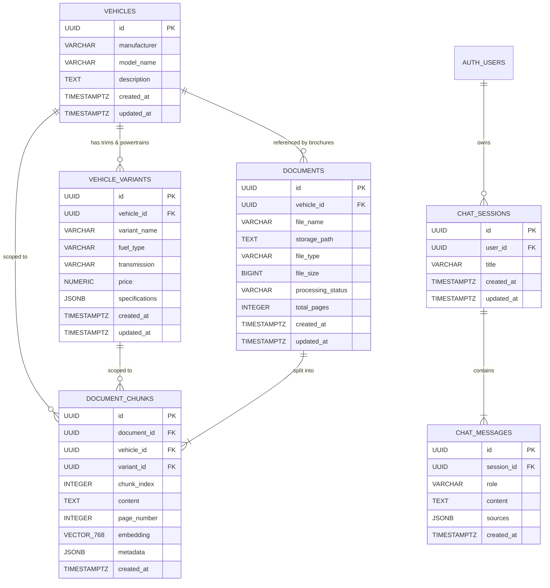

# Automotive AI Assistant - Architecture & Specification

## System Architecture

The Automotive AI Assistant is designed as an enterprise-grade RAG-powered application for automotive technical assistance, manual querying, variant comparison, and vehicle diagnostic workflows.

```
+-------------------------------------------------------+
|                Next.js Frontend (React/TS)             |
|       - Clean Automotive Tech UI (Tailwind CSS)       |
|       - Lucide React Iconography                      |
+---------------------------+---------------------------+
                            |
                     REST APIs (HTTP/JSON)
                            |
                            v
+-------------------------------------------------------+
|                 FastAPI Backend Service               |
|       - Modular App Architecture (api, services, rag) |
|       - PyMuPDF PDF Ingestion & Chunking Pipeline     |
|       - Google Gemini Embedding Generation            |
|       - Google Gemini RAG Generation                  |
+---------------------------+---------------------------+
                            |
                 Vector / Relational Query
                            |
                            v
+-------------------------------------------------------+
|              Supabase PostgreSQL Database             |
|       - pgvector Extension (Cosine Similarity)        |
|       - HNSW Vector Indexing                          |
|       - Document Chunks & Metadata Store              |
|       - Private Storage: automotive-brochures         |
+-------------------------------------------------------+
```

---

## Database Architecture & Entity Relationships

The schema is built on Supabase PostgreSQL with the `pgvector` extension and Row Level Security (RLS) enabled across all tables.

### Entity Relationship Diagram (ERD)



---

## Detailed Component Specifications

### 1. Database Relationships & Referential Integrity
- **Vehicles -> Vehicle Variants**: One-to-many relationship with `ON DELETE CASCADE`. When a vehicle is removed, all associated variants and technical specs are pruned.
- **Vehicles -> Documents**: Optional one-to-many relationship with `ON DELETE SET NULL`. If a vehicle model record is deleted, general brochures remain preserved.
- **Documents -> Document Chunks**: One-to-many relationship with `ON DELETE CASCADE`. Removing a brochure automatically cleans up all associated chunk embeddings.
- **Vehicle Variants -> Document Chunks**: Optional foreign key enabling granular retrieval filtered by specific vehicle trims.
- **Chat Sessions -> Chat Messages**: Strict one-to-many relationship with `ON DELETE CASCADE`.

### 2. Document Storage (`automotive-brochures`)
- **Storage Layer**: Private Supabase Storage bucket named `automotive-brochures`.
- **File Restrictions**: Only `application/pdf` MIME types are permitted.
- **File Size Limit**: Capped at 20 MB (`20,971,520` bytes).
- **Access Control**: Public access is disabled (`public = false`). Direct reads are restricted to authenticated sessions and the backend service role.
- **Tracking**: The `documents` table stores `storage_path`, `file_size`, `file_type`, and a strict `processing_status` lifecycle (`pending` -> `processing` -> `completed` / `failed`).

### 3. Embedding Storage & Model Alignment
- **Embedding Model**: Google Gemini `gemini-embedding-001`.
- **Output Dimensionality**: Exact 768 dimensions.
- **Vector Column**: `document_chunks.embedding VECTOR(768)` backed by `pgvector`.
- **Metadata**: JSONB field storing chunk tokens, section headers, and hierarchical headings to assist in retrieval reranking.

### 4. Vector Retrieval & Similarity Search (`match_document_chunks`)
- **Index Type**: Hierarchical Navigable Small World (`HNSW`) index built with `vector_cosine_ops`:
  ```sql
  CREATE INDEX idx_document_chunks_embedding_hnsw 
  ON document_chunks 
  USING hnsw (embedding vector_cosine_ops)
  WITH (m = 16, ef_construction = 64);
  ```
- **Similarity Metric**: Cosine similarity computed as `1 - (embedding <=> query_embedding)`.
- **Stored Procedure**: `match_document_chunks` accepts:
  - `query_embedding`: Dense 768-dimensional vector from `gemini-embedding-001`.
  - `similarity_threshold`: Cutoff score (between 0.0 and 1.0) to filter noisy text chunks.
  - `match_count`: Result limit (clamped between 1 and 100).
  - `filter_vehicle_id`: Optional UUID filter to scope searches to a specific vehicle model.

### 5. Chat History & Grounded Citations
- **Sessions**: Stored in `chat_sessions`, linking to Supabase `auth.users(id)` with cascading deletion.
- **Turns & Roles**: Validated via `CHECK (role IN ('user', 'assistant'))`.
- **Grounded Citations**: The `sources` column in `chat_messages` stores structured JSONB citations referencing:
  - Document chunk IDs (`document_chunk_id`)
  - Document file names
  - Page numbers
  - Similarity scores
  This provides full explainability and verification for generated technical answers.

---

## Security Model & Row Level Security (RLS)

1. **Vehicles & Variants**: Read access granted to authenticated users. Modifications reserved for administrative/service roles.
2. **Documents & Chunks**: Read access available for retrieval pipelines. Writes restricted to backend extraction services.
3. **Chat Sessions & Messages**: Strict row isolation — users can only view, insert, update, or delete sessions and messages where `auth.uid() = user_id`.
4. **Backend Service Role**: The backend FastAPI service connects using the Supabase `service_role` secret to bypass RLS for administrative tasks like document ingestion, chunk writing, and embedding updates.
